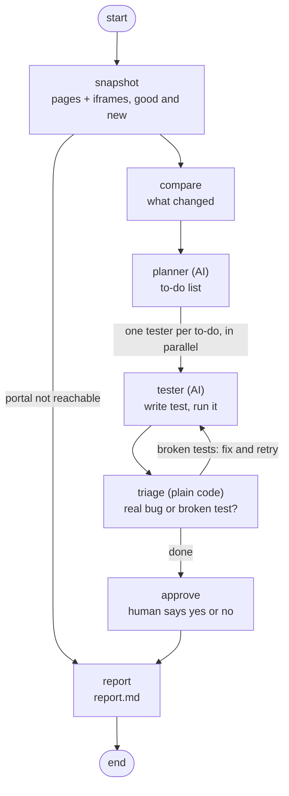

# PortalGuard

[](https://github.com/anupbpote02/portalguard-langgraph/actions/workflows/qe.yml)

## What is PortalGuard?

PortalGuard is a team of AI helpers that tests a hospital patient portal (the website where patients
sign in to see appointments and lab results) every time it's updated. It finds what broke, checks
its own work, and writes a bug report for a person to approve. It's built with three open-source
tools: LangChain, LangGraph and LangSmith.

## Why it matters

A small update can quietly break the portal for patients. Blind patients use screen readers (apps
that read the page aloud), so a button with no label or a missing heading can lock them out. Bugs
also hide inside iframes (a page embedded inside another page, like the lab results box), where many
testing tools never look.

## How it works

1. **Snapshot:** take a "snapshot" of each page as a screen reader sees it (the accessibility tree),
   including inside every iframe, for the last good version and the new one.
2. **Compare:** list everything that changed between the two snapshots.
3. **Planner:** an AI agent (an AI model that can use tools) writes a to-do list of things to test.
4. **Parallel testers:** one small AI tester per to-do item writes a browser test and runs it, all
   at the same time.
5. **Triage:** plain code, not AI, decides what each failure means. If a test also fails on the good
   version, the test is wrong, so the tester fixes it (up to 3 tries). If it only fails on the new
   version, it's a real bug.
6. **Human approval:** the run pauses and asks a person to approve the findings.
7. **Report:** write `report.md` with each bug, the proof, and how to reproduce it.

This is the real workflow (from `portalguard/graph.py`):



## What each tool does

| Tool | Its job here |
|---|---|
| **LangChain** | Connects to the AI model (OpenAI's gpt-4.1-mini) and gives it tools: take a snapshot, compare snapshots, write a test, run tests. |
| **LangGraph** | Runs the workflow above: the steps, running testers in parallel, the pause for human approval, and saving progress so a run can resume. |
| **LangSmith** | Records every step of every run (tracing) so you can see what the AI did, and scores the agent against known bugs (evals). |

## Quick start

You need Python 3.12. "Mock mode" uses a fake, scripted AI, so it's free and needs no API key.

**Windows (PowerShell):**

```powershell
python -m venv .venv
.venv\Scripts\activate
pip install -r requirements.txt
python -m playwright install chromium
python -m portalguard.main --mock --auto-approve
```

**macOS / Linux:**

```bash
python3 -m venv .venv
source .venv/bin/activate
pip install -r requirements.txt
python -m playwright install chromium
python -m portalguard.main --mock --auto-approve
```

The tool starts the practice portal for you at http://localhost:8000/ and tests the buggy version.
The report lands in `runs/<run id>/report.md`.

Other commands:

```bash
python -m portalguard.main --mock                   # same, but asks you to approve the report
python -m portalguard.main --mock --release good    # test the good version (should find no bugs)
python -m pytest tests/unit -q                      # unit tests for the safety rules
python -m evals.run_eval --local                    # score the agent against the 4 planted bugs
```

To use the real AI model, copy `.env.example` to `.env`, add your `OPENAI_API_KEY` (and optionally
`LANGSMITH_API_KEY` for tracing), then run `python -m portalguard.main --real`.

**Test patients** (fake data, in `portal/test-users.json`):

| Name | Email | Password | Patient ID (MRN) |
|---|---|---|---|
| Jordan Rivera | jordan.rivera@test.example | Test123! | TEST-000123 |
| Casey Morgan | casey.morgan@test.example | Test456! | TEST-000456 |
| Riley Nguyen | riley.nguyen@test.example | Test789! | TEST-000789 |

## Results

The buggy version has 4 planted bugs. Here's how the agent scored with the real AI model
(gpt-4.1-mini):

| Run | Recall | Precision | False alarms | Cost |
|---|---|---|---|---|
| Run 1 | 75% (3 of 4) | 100% | 0 | $0.044 |
| Run 2 | 75% (3 of 4) | 100% | 0 | $0.062 |
| Run 3 | 75% (3 of 4) | 100% | 0 | $0.048 |

- **Recall:** how many of the planted bugs it found.
- **Precision:** how many of the bugs it reported were real.
- **False alarms:** bugs it reported on the good version, which has none.
- **Cost:** what the AI model cost for one run on both versions.

Recall is 75% because the agent keeps missing the bug inside the lab results iframe. It writes a
check for that bug, but another mistake in the same test hides the result.

(Mock mode finds all 4 bugs with no false alarms, and that's checked on every push.)

## Safety and healthcare

- **Fake patient data only:** the three test patients above are made up.
- **Local website only:** the agent and its tests can only visit `localhost`, never the internet.
- **Human approval before reporting:** nothing is reported until a person approves it.
- **Budget limits:** each run stops at 40 AI calls, 300,000 tokens, or $0.25, whichever comes first.

## Project layout

```
portal/
  good/                  the last good version of the patient portal
  buggy/                 the new version, with 4 planted bugs
  test-users.json        the 3 fake test patients
portalguard/
  main.py                command line: run the agent on a version
  graph.py               the LangGraph workflow (the steps above)
  agents.py              the planner and the testers
  tools.py               the tools the AI can use
  llm.py                 the AI model (real or fake)
  mock.py                the fake AI's scripted answers
  browser.py             browser snapshots and running tests
  triage.py              decides real bug vs broken test
  coverage.py            checks each test really tests its journey
  safety.py              budget limits and the localhost-only rule
  fixtures.py            shared setup for the generated tests
  report.py              writes report.md
  tracing.py             LangSmith tracing setup
  config.py              settings: model, budgets, paths
evals/
  expected_bugs.json     the answer key (the 4 planted bugs)
  scoring.py             recall, precision, false alarms
  run_eval.py            runs the agent on both versions and scores it
  history/               saved results from the real runs
tests/unit/              one test per safety rule, plus scoring
.github/workflows/qe.yml CI: runs the unit tests and the mock eval on every push
runs/                    each run's snapshots, tests and report (not in git)
```
