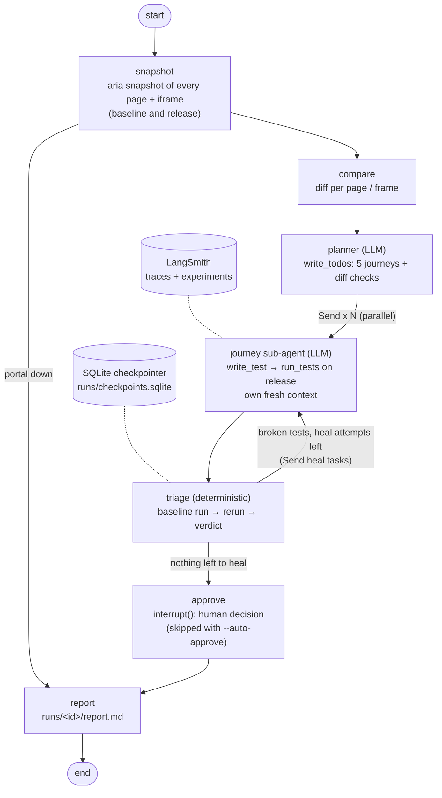

# PortalGuard

**An AI QE agent that tests every release of a hospital patient portal, built on LangChain,
LangGraph and LangSmith.** It diffs the accessibility tree of each page *and every iframe* against
the last good release, plans the journeys to test, gives each journey its own sub-agent (in
parallel) to write and run a Playwright test, triages every failure against the baseline, heals its
own broken tests, and asks a human to approve before it publishes a bug report.

The model proposes; the harness decides. Pass/fail comes from Playwright, verdicts come from
deterministic triage, and the report is built from graph state, never from model text.

The portal is a fictional "Harbor General Patient Portal" with synthetic patients only. A buggy
release carries four planted bugs: three accessibility regressions (one inside an iframe) and one
functional bug.

## Quick start

```bash
python -m venv .venv && .venv\Scripts\activate          # macOS/Linux: source .venv/bin/activate
pip install -r requirements.txt
python -m playwright install chromium
cp .env.example .env                                     # only needed for --real and LangSmith

python -m portalguard.main --mock                        # $0, no keys: QE run on the buggy release
python -m portalguard.main --real --release buggy        # gpt-4.1-mini
python -m portalguard.main --mock --release good --auto-approve
python -m portalguard.main --resume <run_id>             # finish a run paused for approval

python -m pytest tests/unit -q                           # one test per safety rule, no browser needed
python -m evals.run_eval                                 # LangSmith experiment (mock); --real for gpt-4.1-mini
python -m evals.run_eval --local                         # same scoring without LangSmith (what CI runs)
```

The portal is served on `localhost:8000` automatically if it isn't already running
(`python -m http.server 8000 --directory portal` works too). Every run writes `runs/<id>/`:
snapshots, generated tests, pytest logs and `report.md`.

## Architecture



| File | Role |
|---|---|
| `portalguard/graph.py` | `StateGraph`, nodes, conditional edges, `Send` fan-out, `interrupt` |
| `portalguard/agents.py` | planner (`write_todos`), journey sub-agent loop, safety checks between model and tools |
| `portalguard/tools.py` | LangChain `@tool`s: `snapshot_page`, `compare_snapshots`, `write_test`, `run_tests` |
| `portalguard/llm.py` | `ChatOpenAI` (gpt-4.1-mini, temperature 0), `ScriptedChatModel` for mock, retries, cost |
| `portalguard/triage.py`, `coverage.py` | baseline-as-oracle verdicts, journey coverage rules (ported from v1) |
| `portalguard/browser.py` | Playwright aria snapshots + diff, AST checks, pytest/JUnit runner |
| `portalguard/fixtures.py` | pytest plugin for generated tests: synthetic patient, `signed_in`, localhost route guard |
| `evals/` | answer key, deterministic scoring, LangSmith dataset + experiment |

## How each requirement maps to the stack

| Requirement | Where | Stack piece |
|---|---|---|
| LLM | `llm.make_model` | `langchain_openai.ChatOpenAI(model="gpt-4.1-mini", temperature=0)` |
| Tools | `tools.py` | `@tool` with pydantic schemas; harness-owned args are `InjectedToolArg` (the model can't see or set them) |
| Mock mode ($0, no key) | `llm.ScriptedChatModel`, `mock.py` | a real `BaseChatModel` subclass, so graph, tools and tracing are identical in both modes |
| QE loop | `graph.py` | `StateGraph`: snapshot → compare → planner → journeys → triage → heal / approve → report |
| Triage decides heal vs report | `graph.after_triage` | conditional edge returning `Send` heal tasks or `"approve"` |
| Deep-agent pattern | `agents.plan_with_llm`, `graph.fan_out` | planner writes a to-do list (`write_todos`); one sub-agent per to-do with its own small context; big data stays on disk, summaries in context |
| Parallel sub-agents | `graph.fan_out` | `Send` API, `max_concurrency=4` |
| Run dependencies | `agents.RunContext` | LangGraph `Runtime` context (model, budget): not checkpointed |
| State + resume | `main.checkpointer` | `SqliteSaver` (thread id = run id) |
| Human in the loop | `graph.approve`, `main.resume_qe` | `interrupt()` + `Command(resume=...)`; `--auto-approve` for CI/evals |
| API retries | `llm.with_api_retries` | `Runnable.with_retry` on transient OpenAI errors only |
| Observability | `tracing.py` | LangSmith tracing on every run (nodes, LLM calls, tools, `@traceable` pytest runs) with run name, tags and metadata, all in one project (`LANGSMITH_PROJECT`), eval runs included |
| Evals | `evals/run_eval.py` | LangSmith dataset `portalguard-releases` + `evaluate()` experiment with deterministic evaluators |
| iframe a11y diff | `browser.take_snapshot` | Playwright `aria_snapshot()` of body + every frame, keyed by iframe id |
| CI | `.github/workflows/qe.yml` | unit tests + mock eval gate on every push; real eval by hand |

## Safety design

Every rule runs in code between the model and the world, and each has a unit test in `tests/unit/`.

| Rule | How | Test |
|---|---|---|
| Step / token / cost budget | `safety.Budget`, shared by all sub-agents (thread-safe), checked **before** every LLM call: 40 steps, 300k tokens, $0.25 per run, 5 calls per sub-agent | `test_budget.py` |
| Localhost-only allowlist | `check_url` in the CLI, the snapshot node and the tools, plus a browser route guard that aborts any non-localhost request from generated tests | `test_allowlist.py` |
| Argument validation | pydantic tool schemas (`journey` is an enum, filename pattern, max sizes); a sub-agent may only write and run *its own* file for *its own* journey; AST checks on test code (allowed imports only, no `exec`/`eval`/`open`/dunders) | `test_arg_validation.py` |
| Baseline-as-oracle | a failing test first runs on the last good release: fails there too → `broken_test` (heal it, max 3); passes there → rerun on the release → `flaky` or `real_bug`. A test that proved a bug is **locked**: rewrites of it are refused | `test_oracle_lock.py` |
| Coverage check | a journey test must exercise its journey (a download test must click, `expect_download()` and check the filename); the planner's plan must contain all 5 journeys (missing ones are added) | `test_coverage.py` |
| API retries | transient errors (connection, timeout, 429, 5xx) retried with exponential backoff; other errors fail fast; a sub-agent's failure stops that sub-agent, not the run | `test_retries.py` |
| Human approval | nothing is published before a human decides; no terminal → the run stays paused | `test_human_approval.py` |

## Eval results

Dataset `portalguard-releases`: the buggy release (expected: the 4 planted bugs) and the good release
(expected: nothing). Scoring is deterministic substring rules in `evals/expected_bugs.json`, with no
LLM judge.

| Run | Recall | Precision | False alarms on good | LLM steps | Tokens | Cost |
|---|---|---|---|---|---|---|
| Mock (CI gate) | 100% (4/4) | 100% | 0 | 34 | 28.9k (estimated) | $0 |
| gpt-4.1-mini, run 1 (LangSmith `portalguard-real-2ca49ffe`) | 75% (3/4) | 100% | 0 | 57 | 79.6k | $0.044 |
| gpt-4.1-mini, run 2, after prompt fix (`portalguard-real-8eee9e05`) | 75% (3/4) | 100% | 0 | 65 | 111.1k | $0.062 |
| **gpt-4.1-mini, run 3, same prompts** (`portalguard-real-0c82d801`) | **75% (3/4)** | **100%** | **0** | 56 | 88.4k | **$0.048** |

QE run traces (every node, LLM call, tool call and pytest run) are in the LangSmith project
`portalguard-langgraph`, for both CLI and eval runs (run 3 onwards for evals). The experiment holds
the scores, plus each run's `run_id` to find its trace.

All three real runs missed BUG-3 (the iframe heading), each for a different reason:

- **Run 1:** the lab-results sub-agent took the diff line `REMOVED: heading "Lab results"` as the
  new spec, so it skipped the heading. It also called `expect()` on a FrameLocator, so the test failed
  on the baseline.
- **Prompt fix:** REMOVED lines exist on the baseline and must be tested; valid `expect()` targets.
- **Run 2:** the fix worked. The test now checks the heading correctly inside the frame. But its last
  line, `to_have_count(lambda c: c >= 1)`, is invalid (Playwright takes an int), so the test still
  failed on the baseline. The model kept that line through all 3 heals.
- **Run 3:** a diff check did check the iframe heading correctly. But it checked the appointments
  heading (BUG-2) first, and pytest stops at the first failure, so the test only proved BUG-2. The
  lab-results journey test used a made-up CSS class and gave up after 3 heals.

Every time, the harness held up: no false bug, and broken tests went to "Needs human review". I
stopped tuning here; this is a known limitation (see below). Details: `analysis.md` in
`evals/history/2026-10-14-real-r1`, `-r2` and `-r3`.

## Healthcare notes

- Synthetic data only (`portal/test-users.json`: Jordan Rivera `TEST-000123`, plus two other test
  users). Downloaded PDFs are stamped DEMO DATA.
- The agent can only reach localhost, both in the harness and inside the browser.
- Keys come only from `.env` (gitignored) and are never printed.
- A real deployment would use Azure OpenAI (or another provider) under a HIPAA BAA with zero data
  retention. LangSmith would be self-hosted, or would use input/output masking
  (`LANGSMITH_HIDE_INPUTS` / `HIDE_OUTPUTS`), since traces contain page content.
- Human approval before any report leaves the system fits a regulated release process: the reviewer
  and their note are recorded in the report.

## Limitations and next steps

- **Known miss: BUG-3 (iframe heading) with gpt-4.1-mini, 0 of 3 real runs.** In two of them the
  agent wrote a correct check for it, but another assertion in the same test hid it. In r2 an invalid
  assertion failed on the baseline; in r3 an earlier assertion failed on the release, so pytest stopped
  first. Possible fixes (not done): one diff line per diff-check test (or collect every failure), a
  guaranteed diff check for every iframe diff, and an AST check for non-literal `to_have_count`
  arguments.
- In "Needs human review", the report quotes the release error for tests that gave up. For those,
  the baseline error (stored as `baseline_error`) is the useful one.
- The real model varies run to run; three real evals are a sample, not a benchmark. Next: 3–5 repeats
  per prompt change, tracked as LangSmith experiments.
- Parallel sub-agents only speed up the write-and-run phase. Triage's baseline runs and reruns are
  sequential, so a mock run takes about 2 minutes either way. Triage could fan out per file too.
- The planner's diff checks are capped at 2; a release with many diffs needs batching.
- AST checks are a guardrail, not a sandbox: CI runners (or containers) are the isolation boundary.
- No long-term memory across runs yet (v1 had baseline reuse and selector fixes); a LangGraph
  `Store` is the natural place for it.
- `deepagents` (LangChain's deep-agent package) could replace the hand-written planner/sub-agent
  loop. I wrote it by hand here so every safety check stays visible and testable.
- On a laptop, idle sleep (Windows Modern Standby) freezes browsers mid-run; runs keep the machine
  awake while they work.
